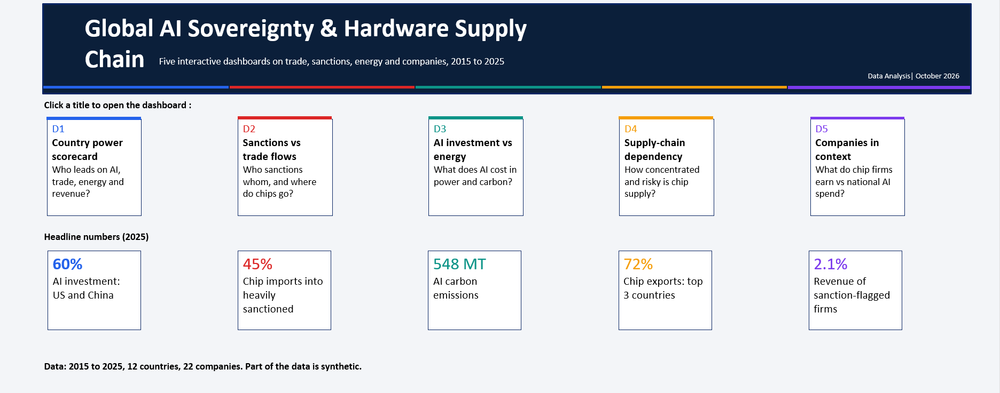
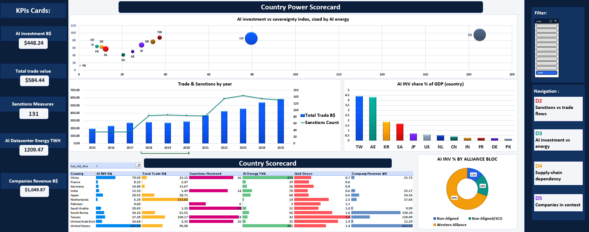
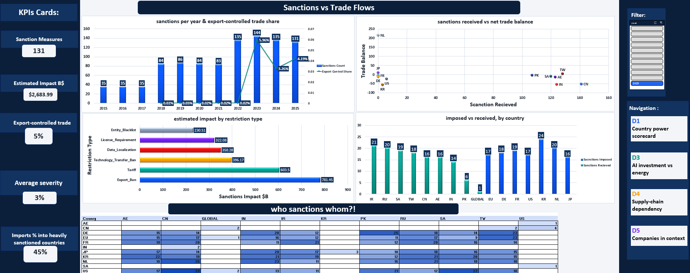
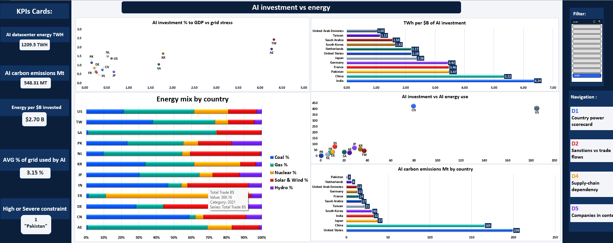
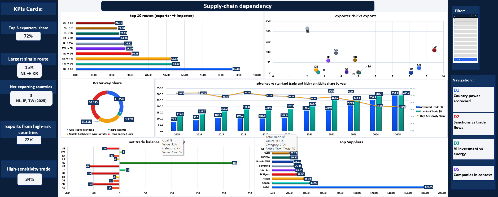
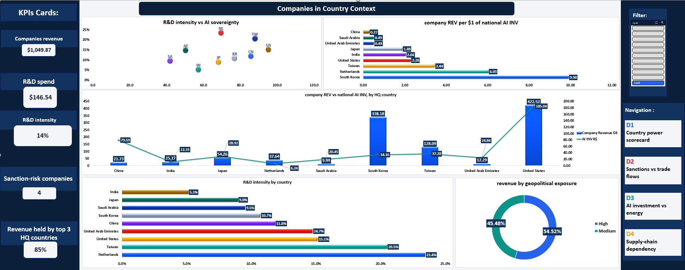

# Chips, Sanctions and the AI Race

Personal portfolio project. An Excel Data Model with five linked dashboards on how semiconductor trade, sanctions, energy use and companies connect (2015-2025), plus the Python exploration behind it. Part of the dataset is synthetic.

## Questions
- Who leads on AI investment, trade, energy and company revenue?
- Who sanctions whom, and where do chips flow?
- What does AI cost in energy, carbon and grid stress?
- How concentrated and risky is the chip supply chain?
- What do chip companies earn compared with national AI investment?

## What is inside
| File | Content |
|---|---|
| AI-sovereignty-project-notebook (.ipynb) | Python data exploration and cleaning (pandas, seaborn, plotly) |
| AI Sovereignty Project.xlsx | Workbook with the Data Model (Power Pivot), DAX measures and 5 dashboards |
| Global_AI_Sovereignty_Hardware_Supply_Chain_Presentation.pptx | Main presentation |
| Measures_KPIs_and_Insights.pptx | Appendix explaining every DAX measure and KPI card |
| Images/ | Dashboard screenshots |
| requirements.txt | Python packages |

## Dashboards

### D1 Country power scorecard
AI investment, trade, energy and revenue by country.

### D2 Sanctions vs trade flows
Who sanctions whom, and where chips flow.

### D3 AI investment vs energy and grid
Electricity, carbon and grid stress.

### D4 Chip supply-chain dependency
Concentration and geopolitical risk.

### D5 Companies in country context
Revenue, R&D and sanction-flagged firms.

## Key findings (2025)
- The US and China hold 59% of AI investment.
- About 45% of chip imports go into heavily sanctioned countries, yet only 4.2% of trade is flagged export-controlled.
- Three exporters (NL, TW, US) ship 72% of chip trade.
- AI datacenters used 1,209 TWh and emitted 548 Mt CO2.
- The four sanction-flagged companies hold 2.1% of company revenue.

## Data model
Star schema: 6 fact tables (trade, sanctions, AI budgets, energy, macro, companies) and 3 dimensions (country, target country, year), joined on country code and year, with about 37 DAX measures.

## How to use
1. Open the Excel workbook in Excel for Windows (the Data Model needs the desktop app) and use the year slicers.
2. To rerun the analysis: `pip install -r requirements.txt`, download the CSV files from [https://www.kaggle.com/datasets/moaz1911/global-ai-sovereignty-and-hardware-supply-chain/data], and run the notebook.

## Limitations
Part of the data is synthetic, all sanctions are marked Active, sanction impact estimates overlap, and the company table is a sample of 22 firms.

## Author
[Mohamed Ramadan Elmenshawy], Business Information Systems student. [[LinkedIn link](https://www.kaggle.com/datasets/moaz1911/global-ai-sovereignty-and-hardware-supply-chain/data)]
